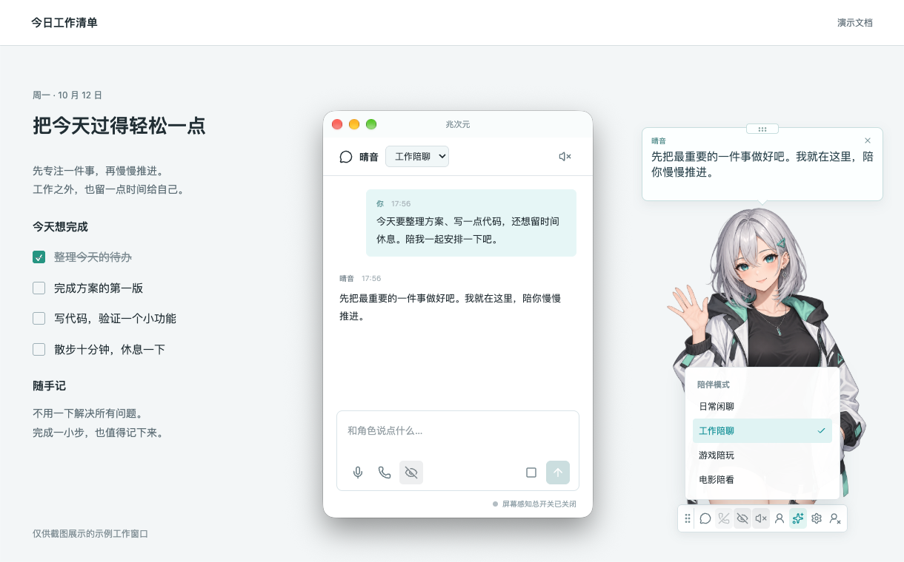
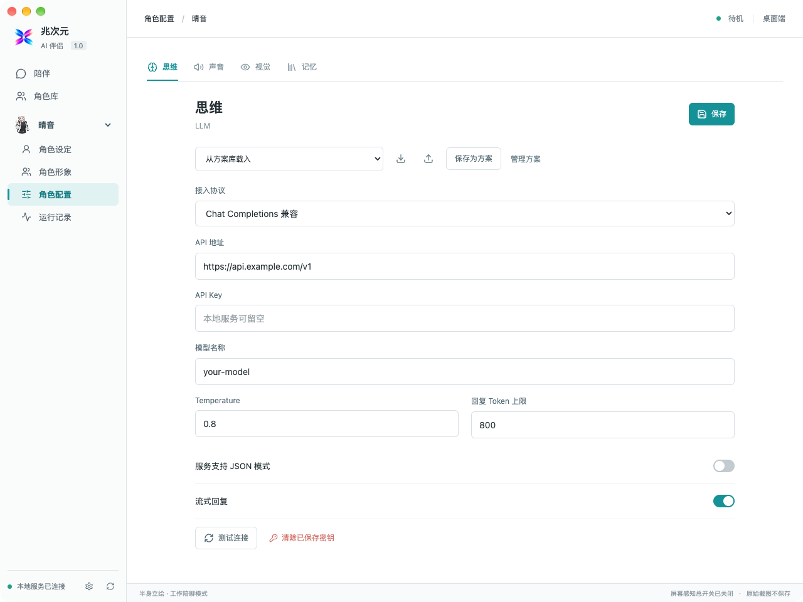

# 兆次元 Zhaociyuan


你选择角色、声音和 AI，让陪伴留在桌面上。

兆次元是一个本地优先的 AI 桌面伴侣：导入喜欢且有使用权的角色形象，自行接入大语言模型和 TTS，为聊天、工作、游戏、观影设置不同的陪伴模式。角色可以通过文字、语音和经过授权的屏幕画面与你互动。

**当前版本为 1.0.0-beta.1，仍处于测试阶段。** 已提供 macOS Apple Silicon 安装包；Windows、Linux 和 Intel Mac 暂无安装版本。

## 界面预览

**桌面陪伴**：悬浮角色、聊天气泡、独立聊天窗与快捷工具栏。



**配置面板**：管理角色与形象，分别配置思维、声音、视觉和记忆。



以上为真实应用截图，使用 AI 生成的原创示例静态立绘、示例配置和示例对话；背景为演示工作窗口。展示角色不随安装包提供，可自行导入立绘或 Live2D 形象。

## 下载测试版

- [测试版 Release 与附件](https://github.com/qian-ramiel/zhaociyuan/releases/tag/v1.0.0-beta.1)
- [macOS Apple Silicon 安装包](https://github.com/qian-ramiel/zhaociyuan/releases/download/v1.0.0-beta.1/Zhaociyuan-1.0.0-beta.1-mac-arm64.dmg)
- [安装说明与首次配置](docs/release/MAC-INSTALL.md)

下载安装 DMG 即可使用，无需安装 Node.js 或 Python。安装包内置本地语音识别和合成模型；角色形象、大语言模型与第三方服务由你自行配置。首次安装请阅读安装说明中的安全提示。

## 已有能力

- **桌面陪伴**：透明角色窗口、独立聊天窗、状态栏菜单、悬停工具栏、拖动、缩放、隐藏和点击穿透。
- **角色自由配置**：静态立绘与 Live2D；一个角色拥有全身、半身、mini 等多形象，可手动或通过聊天切换，配置表情、动作与口型。
- **自己的模型和声音**：Chat Completions 兼容 LLM API；对话与视觉模型可分开配置；本地 Kokoro、MiniMax HTTP 和 OpenAI 兼容 TTS；本地 SenseVoice ASR。
- **文字与语音互动**：流式回复、按句合成与播放、录音转写、持续通话、插话打断，以及按住说话、松开发送。
- **有开关的视觉**：手动、发送消息时、定时与画面变化触发截图；选择窗口、区域裁切和画质，聊天中可预览本次画面。识别结果依赖模型，不能保证小字识别或游戏建议准确。
- **自定义陪伴模式**：模式名称、提示词、默认形象、回复长度、主动互动、冷却、安静时段及表单工作流。
- **记忆与资料**：可管理的长期记忆、知识资料检索、角色与无密钥服务配置导入导出、运行记录。

听觉开关控制麦克风，不是系统音频监听。没有实现系统声音捕获、连续长视频理解、VRM、节点式工作流、云同步或插件市场。没有内置云端账号或赠送模型额度。

## 从源码启动

目前开发和打包以 macOS 为主。需要 Node.js 22.12+、Python 3.12.15 或更新的 3.12 补丁版，以及你自行配置的模型服务。仓库不包含个人角色、API Key、聊天记录或语音模型权重。

```bash
npm ci
npm run setup:api
# 可选：下载本地 ASR / TTS 权重，约 1.5 GB
npm run setup:speech
npm run dev
```

也可双击 `启动AI伴侣.command`。`npm run dev:web` 只启动网页预览；原生屏幕捕获、状态栏和快捷键使用 Electron 桌面端。

默认网页端口为 `127.0.0.1:4317`，API 为 `127.0.0.1:8791`，冲突时自动寻找空闲端口。应用仅启动本地服务，不应将它暴露到公网。

首次使用：创建角色，导入有使用权的形象，配置 LLM / TTS，然后设置陪伴模式。需要看屏幕时，使用支持图片输入的对话模型，或另配视觉模型，并开启相应权限。非多模态模型不能直接理解截图。

## macOS 安装与构建

安装包面向 macOS 13+、Apple Silicon，尚未覆盖所有系统版本和设备。当前只有 ad-hoc 完整性签名，没有 Apple Developer ID 签名与公证。

构建前需要本地语音资源及额外打包依赖，详见 [macOS 安装与构建](docs/release/MAC-INSTALL.md)。产物留在 `releases/`，不进入 Git。

## 安全与隐私

屏幕录制、麦克风、辅助功能分别由 macOS 授权；还需满足应用开关、角色及模式设置。配置第三方服务后，聊天、需要的记忆片段、截图或语音文本可能发送给你选定的服务商。**本地优先不等于所有推理都离线。**

密钥优先存入系统钥匙串；钥匙串不可用时可能退回本地 `secrets.json`，该文件不加密，只限制文件访问权限。角色包和服务方案导出不含 API Key。不要公开运行数据、用户导出的角色包、聊天截图或完整诊断文件。详情见 [隐私说明](docs/PRIVACY.md) 和 [安全报告](SECURITY.md)。

## 开发与贡献

源码结构、验证命令及测试边界见 [开发说明](docs/DEVELOPMENT.md)；后续方向见 [路线图](docs/ROADMAP.md)。贡献前请阅读 [贡献说明](CONTRIBUTING.md)。当前版本适合参与测试和开发，不适合依赖它执行高风险任务。

## 授权与版权

Copyright (c) 2026 qian-ramiel. Original Zhaociyuan code.

原创应用代码采用 **Zhaociyuan License 1.0**。个人非商业使用、学习及直播内容创作可按协议使用；收费托管、商业套壳和集成到收费产品需要另行取得许可。**这是带商业用途限制的源码可见许可，不是 MIT 或 Apache-2.0 开源许可。** 完整条款见 [LICENSE](LICENSE)。

Live2D Core、Framework、Samples、第三方库、语音权重和角色素材保留各自许可；应用许可不替代其使用或发行条款。见 [授权说明](docs/LICENSING.md)、[Live2D 说明](LICENSE-Live2D.md) 和 [第三方声明](NOTICE.md)。

商业许可请通过 [维护者 GitHub 主页](https://github.com/qian-ramiel) 联系，签署书面授权前不视为已获许可。欢迎试用、反馈和支持这个仍在成长中的桌面伴侣。
